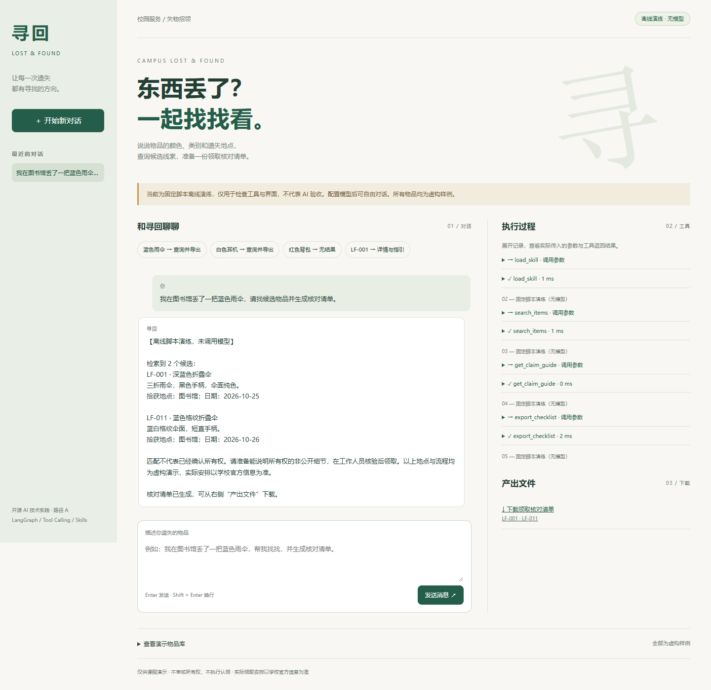

# 寻回 · 校园失物招领智能助手

《开源 AI 技术实践》期末项目，**路径 A**。面向遗失物品的同学，通过自然语言检索虚构校园物品库，获取领取核对指引，并生成可下载的 Markdown 清单。

小组成员：陈彦喆（F25015421）、陈科宇（F25011219）。



> 这是课程原型，不是学校官方失物平台。物品、服务台、领取流程全部是虚构样例。AI 编程助手参与了代码、测试和文档的编写，提交者需实际运行、理解核心代码，并按课程要求说明参与方式。

## 先看这里

- 默认启动 **demo 离线演练**：固定脚本驱动真实业务工具，方便检查界面、检索和文件导出。它没有调用模型，不能作为“已完成真实 AI 验收”的证据。
- 设置 **live 模式**：通过 OpenAI 兼容接口调用通义千问或你配置的其他支持 Tool Calling 的模型，工具选择与参数由模型生成。
- 本次交付已通过自动化测试和浏览器验证，详见 `docs/验证记录.md`。真实云端模型调用需你在本机配置有效密钥后运行 `npm run verify:model`。
- 不需要 Python；本项目采用 JavaScript 版本的 LangGraph。运行环境：Windows 10/11，Node.js 22 或更高版本（本机实测 24.16.0），npm。

## Windows 安装与启动

在解压后的项目文件夹中打开 PowerShell，执行：

```powershell
npm.cmd ci
Copy-Item .env.example .env
npm.cmd start
```

如果已经存在 `.env`，跳过复制命令，避免覆盖你的配置。打开终端显示的本机地址，默认是 http://127.0.0.1:3210 。按 Ctrl+C 停止。也可以双击 `启动项目.cmd`，首次运行会自动安装依赖并创建缺失的 `.env`。

Node.js 下载：https://nodejs.org/ 。若 npm 下载失败，可使用 `npm.cmd ci --registry https://registry.npmjs.org`。端口占用时在 `.env` 改为 `PORT=3211`。

## 启用真实模型

用本地文本编辑器打开 `.env`，不要把密钥贴到聊天、幻灯片或仓库。填写：

```dotenv
AGENT_MODE=live
OPENAI_BASE_URL=https://dashscope.aliyuncs.com/compatible-mode/v1
OPENAI_API_KEY=填写你自己的密钥
OPENAI_MODEL=qwen-plus
PORT=3210
```

上述地址是百炼北京地域常见示例。请以你的百炼控制台给出的地域、业务空间、模型权限和 OpenAI 兼容地址为准。其他服务可替换 Base URL、密钥和模型名。调用可能消耗该服务的额度。

若已部署 Ollama，可配置本机 OpenAI 兼容地址 `http://127.0.0.1:11434/v1`、`OPENAI_API_KEY=ollama` 和实际已安装、支持工具调用的模型名。本项目未下载模型权重，也未实测 Ollama。

保存后重启服务；页面右上角应显示“真实模型”。执行：

```powershell
npm.cmd run verify:model
```

该命令会真实调用模型，以“图书馆蓝色雨伞”为任务，检查 Skill→检索→指引→文件导出是否完成。通过后记录保存在被 Git 忽略的 `runtime/live-verification.json`。401/403 一般需检查密钥或权限；429 检查额度/限流；404 检查地址和模型名。错误不会自动伪装成离线成功。

## 演示话术

前四条对应界面按钮，demo 和 live 模式均可使用；第五条用于真实模式多轮演示。

1. 我在图书馆丢了一把蓝色雨伞，请找候选物品并生成核对清单。
2. 我在教学楼丢了白色耳机，请查询并生成核对清单。
3. 我在食堂丢了红色背包，请帮我查一下。
4. 请详细介绍 LF-001，并说明领取时需要核对什么。
5. 上面两把伞有什么区别？请重新查询确认，只给 LF-001 生成一份核对清单。

第一条应查到 LF-001 深蓝色折叠伞与 LF-011 蓝色格纹折叠伞。第二条查到 LF-003。第三条应无匹配，不会自动放宽条件或生成清单。事实以工具结果为准，模型回复措辞可能不同。

## 技术栈与路径 A 对照

- **模型**：使用 fetch 调用 OpenAI 兼容 Chat Completions；默认配置 qwen-plus，需凭据实测。
- **开源 Agent 框架**：`@langchain/langgraph`，模型节点和工具节点构成循环，8 次模型调用上限。
- **自定义工具**：`search_items`、`get_item`、`get_claim_guide`、`export_checklist`，外加 `load_skill`。
- **Skill**：`skills/lost-found-checklist/SKILL.md`，包含标准 name/description 前置元数据。应用通过工具显式加载，不声称框架自动发现或执行所有 Agent Skills 特性。
- **交互界面**：本地 HTML/CSS/JavaScript，Node.js HTTP 服务。无需前端构建，也没有 CDN 依赖。
- **多轮与保存**：真实模式保留完整模型/工具消息链；成功回合和工具日志写入 JSON，会话重启可恢复。
- **产出物**：根据已检索物品生成 Markdown 清单，固定保存在 `runtime/exports/<会话编号>/`。

七项均有对应实现；其中真实模型效果与自然语言多轮质量在有效凭据配置前仍属待验收项。没有实现 MCP、子代理、RAG 向量检索或长期用户画像，不将这些内容列为已完成能力。

## 项目结构与关键代码

```text
src/agent.mjs       模型接口适配、LangGraph 循环、明确标注的离线脚本
src/tools.mjs       参数校验、条件交集检索、候选验证、清单文件生成
src/server.mjs      本机 HTTP 服务、会话持久化、NDJSON 工具事件流
public/            操作界面（不含密钥）
data/              虚构物品库和演示领取流程
skills/            失物核对 Skill
tests/             工具、协议和 HTTP 集成测试
scripts/           真实模型验收、浏览器验证、幻灯片生成脚本
presentation.html  可双击打开的 10 页答辩幻灯片
docs/              演示讲稿、提交清单、验证记录
runtime/           本机生成的会话、清单、验证记录（不入 Git）
```

答辩优先解释三处：

1. `src/agent.mjs` 的 `runAgent`：模型返回 `tool_calls` 时进入工具节点，否则结束；工具输出通过 `tool_call_id` 回填，再由模型解释。
2. `src/tools.mjs` 的 `executeTool`：类别/颜色/地点取交集，零结果不擅自放宽；导出只接受已检索、待认领的编号，路径由程序生成。
3. `src/server.mjs` 的 `/api/chat`：工具事件逐条发送到浏览器，成功结果原子写入会话文件；同会话不同时执行两轮请求。

这里的“流式展示”指执行事件逐条显示，不是模型 token 流式生成。检索采用结构化条件匹配，不是向量检索。

## 与课堂实验的关系、增量与参考

依据作业图片，借鉴 demo_2 的 OpenAI 兼容接口和 Tool Calling、demo_3/4 的环境变量密钥管理、demo_5 的 Agent 与 Skill 思路。**没有收到或复制课堂仓库代码，因此不能声称已逐行比较课堂实现。**

本项目新增的具体业务实现包括：校园失物字段和样例数据、条件交集检索、候选物品核对规则、可下载的核对清单、与业务配套的 Skill、会话恢复与可展开的执行日志。不是只更换聊天窗口标题或系统提示词。

参考来源：
- LangGraph 官方工作流与 Agent 文档：https://docs.langchain.com/oss/javascript/langgraph/workflows-agents
- 百炼 Function Calling：https://help.aliyun.com/zh/model-studio/qwen-function-calling
- 百炼接口地址说明：https://help.aliyun.com/en/model-studio/base-url
- Agent Skills 格式：https://agentskills.io/specification
- Node.js：https://nodejs.org/
- 本次提供的《开源 AI 技术实践》期末考查要求图片。

AI 使用说明：本初稿由 Codex 辅助生成与验证；请如实补充你实际做过的修改、模型配置和测试记录。不要将未完成的测试或不存在的个人贡献写入材料。答辩前需要能自行解释上述三处代码。

## 测试、数据与使用边界

```powershell
npm.cmd run check
npm.cmd test
```

自动化测试无需密钥。协议测试使用本地 HTTP 模拟模型，不证明云端模型可用。浏览器验证脚本使用 Playwright 和本机 Edge；按需运行 `node scripts/browser-qa.mjs`，输出保存在 `runtime/qa/`。

密钥只从服务端环境变量读取；`.gitignore` 排除 `.env`、依赖缓存和运行数据。服务仅监听本机地址，拒绝异源写入请求。文件下载仅匹配受限路径。模型与用户均不能传入任意导出路径。

这不是面向公网的多用户系统，没有账户认证或生产级访问控制。所有本机用户共用本地数据。真实模式会向所配置的模型服务传输对话与工具结果，不应输入真实个人隐私。领取指引是虚构演示，不作为真实校规。项目不执行删除、认领、发送通知等业务写操作。

## 答辩与提交

双击 `presentation.html`，方向键翻页，F 全屏。封面姓名与学号可直接点击编辑，再点击“保存填写后的 HTML”下载包含修改内容的副本。无需联网或启动服务。

按 `docs/演示与答辩讲稿.md` 排练约 4 分钟介绍 + 4 分钟操作。提交前按 `docs/提交清单.md` 补齐姓名学号、真实模型验收和远程 Git 仓库地址。仅本地源码包不能代替老师要求的可访问仓库链接。
